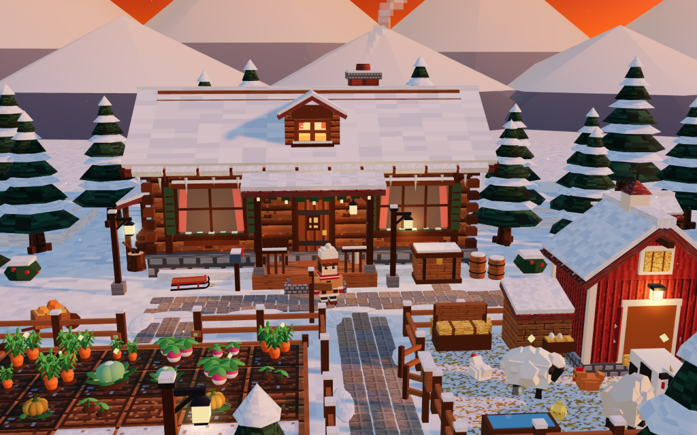
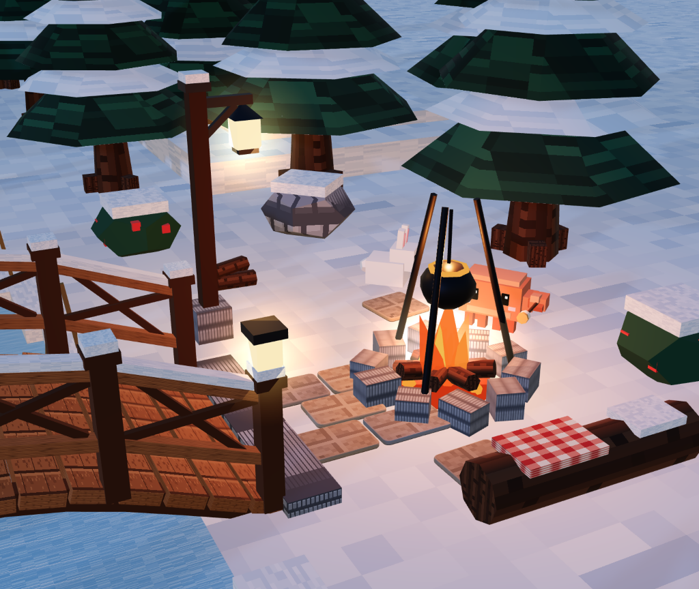
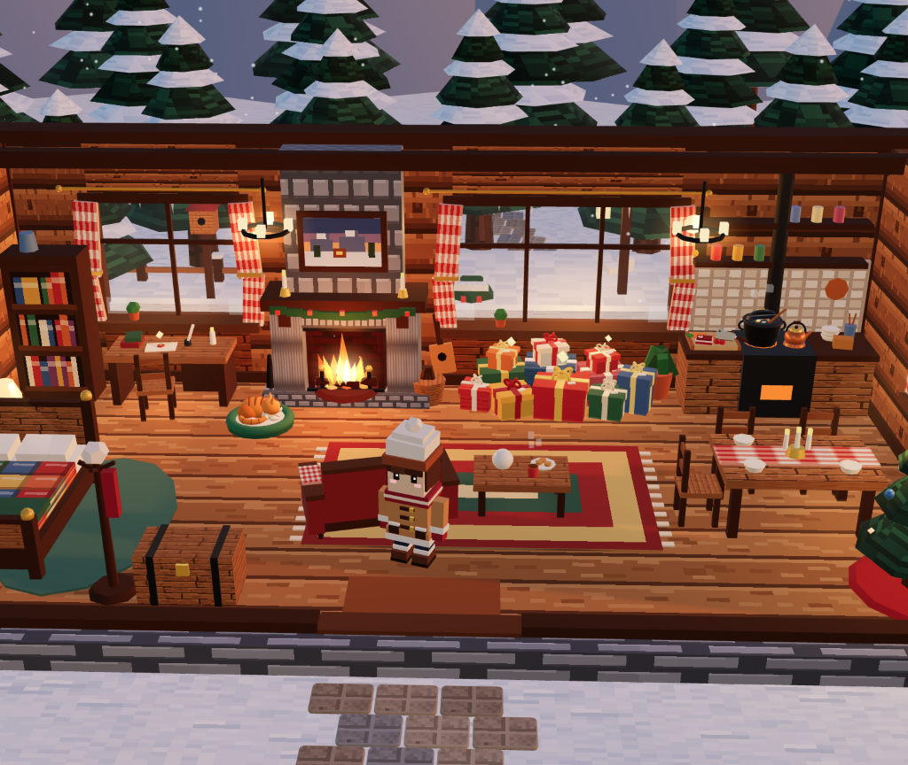
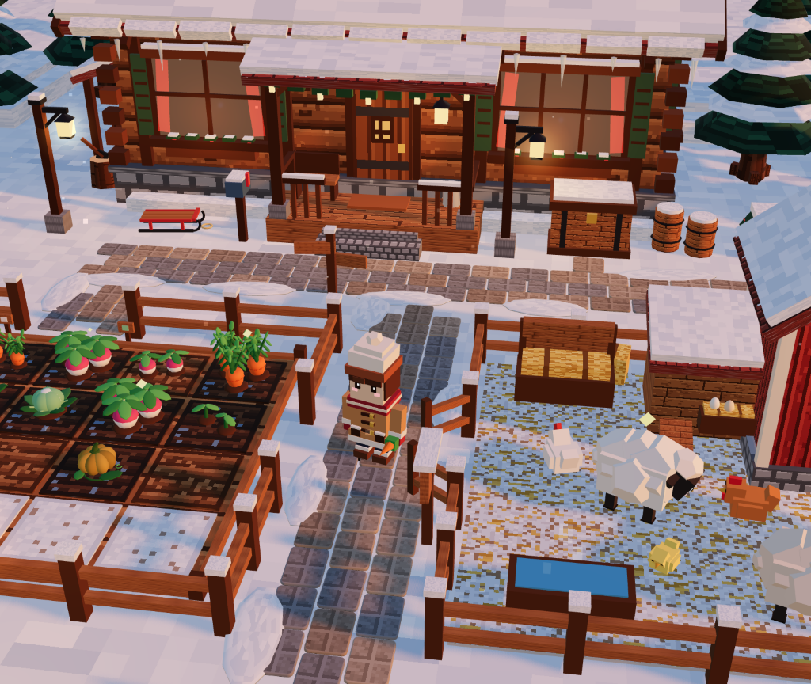

# 冬麓 · Winterfoot

一个用 three.js 做的冬日小屋生活小游戏：雪山脚下的小屋、菜园、牧场、篝火边的小螃蟹，还有每天早上送到信箱的信。最初是作为一份生日礼物做的。



## 地图

- **冬麓院子**：小屋、菜园、牧场、水井、桥和篝火边的小螃蟹。
- **松林小径 → 镜湖**（从菜园南口往南）：结冰的湖、码头长椅、冰钓洞和小木屋、湖边雪人。
- **山脚小径 → 山脚温泉**（从小屋西侧往北）：冒着热气的露天温泉、冰瀑，黄昏时偶尔会有一只鹿。
- **观星台**（温泉往西）：木平台上的望远镜，夜里可以看星星，运气好能看到极光。

区域范围定义在 `js/zones.js`，南北两块的内容分别在 `js/zoneSouth.js` 和 `js/zoneNorth.js`。

## 运行

需要 [Node.js](https://nodejs.org/)。

```bash
node server.mjs 8090
```

然后打开 http://127.0.0.1:8090/ 。Windows 下也可以直接双击 `start.bat`。

three.js 已放在 `vendor/three`，不需要联网安装依赖。

## 做成你自己的礼物

1. 把 `js/gifts.example.js` 复制为 `js/gifts.js`，改里面的名字、对白、信件。
2. 照片和手写信放进 `assets/gifts/`，在 `js/gifts.js` 里填对应路径。
3. `js/gifts.js` 和 `assets/gifts/` 已在 `.gitignore` 里，不会被提交。没有 `js/gifts.js` 时游戏使用示例配置。

地址后加 `?reset=1` 可以清空进度从头体验。

## 截图

| | |
|---|---|
|  |  |
|  | |
